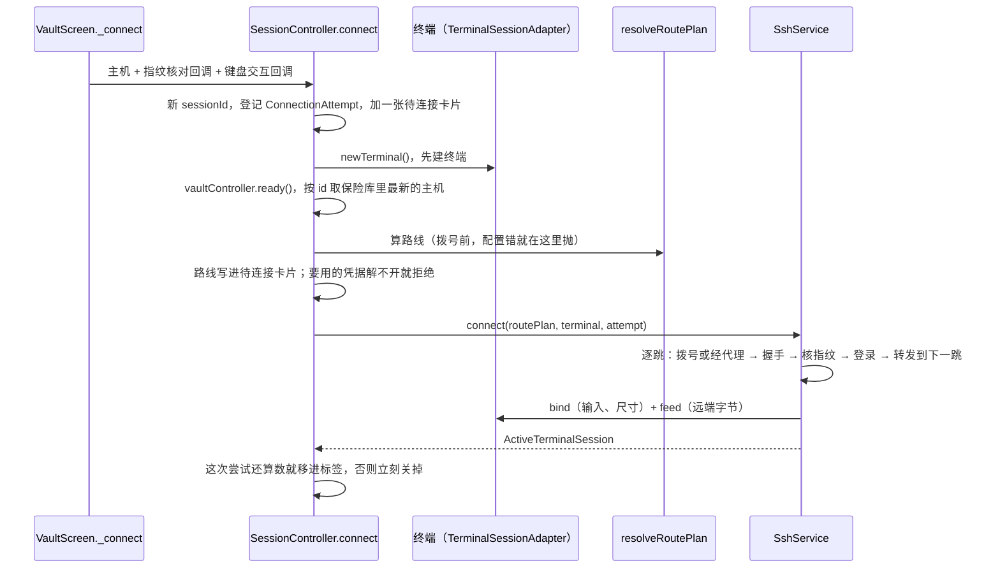
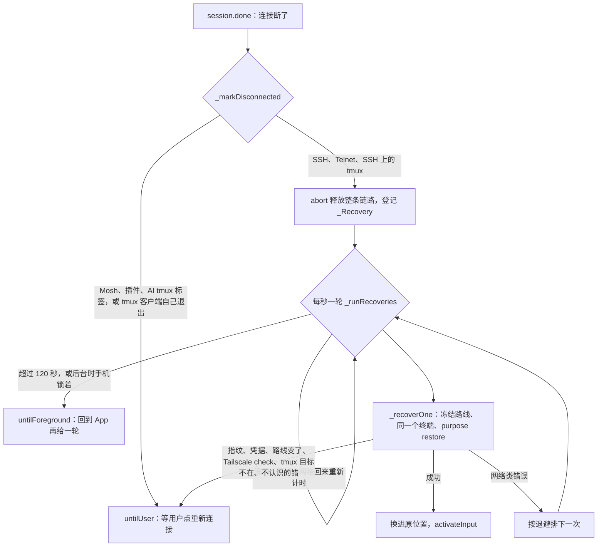

# shun 架构

写给第一次接手这份代码的人：一个功能的数据从哪到哪、改一处会牵连什么。只写代码里现在有的；写不下的细节给出文件和类名，以代码为准。

别处已经写清楚的不在这里重复：

- 装环境、跑测试、起 Docker 测试环境、装真机：[本机手册](README.md)。仓库每个目录放什么在它的[第 8 节](README.md#8-仓库里有什么)。
- App 对用户表现成什么样：[使用手册](../user/README.md)。
- 插件的接口约定：[插件作者文档](../plugin-authors/README.md)。
- 做到哪了、哪些用例过了：`plan/v3/STATUS.md`、`plan/v3/evidence/`。

读代码前先知道两件事，不然注释看不懂：

1. 注释里的 `docs/04`、`docs/07`、`docs/16` 指的是 `plan/v3/docs/04-network-routes.md`、`07-security-lifecycle.md`、`16-mosh-plugin.md` 这些计划文档，不是仓库根下的 `docs/`。
2. `R22`、`X09` 是任务号，`SEC07`、`LIFE05`、`TMX04` 是验收用例号，定义在 `plan/v3/tasks.json` 和 `plan/v3/verification-cases.json`，每批实测在 `plan/v3/evidence/<任务号>.md`。看到一条不明白的规矩，按编号去那里查为什么。

## 1. 分层与状态管理

`lib/` 下 192 个 Dart 文件，除 `main.dart`、`app.dart` 外分四层：

| 层 | 文件 / 行数 | 放什么 | 代表 |
|---|---|---|---|
| `domain/` | 29 / 约 4200 | 纯数据和纯规则：保险库模型、路线计算、tmux 目标身份、Mosh 引导脚本。不引 Flutter，不做网络和存储操作，外部包只用 `cryptography`、`plugin_api` | `connection_route.dart` 的 `resolveRoutePlan` |
| `application/` | 34 / 约 9000 | 跨页面的状态和流程：会话、保险库、插件、同步、Tailscale 目录。几乎都是 Riverpod 的 `StateNotifier` | `session_controller.dart` 的 `SessionController` |
| `infrastructure/` | 51 / 约 17000 | 和外界打交道：SSH（dartssh2）、代理握手、tmux 命令、SFTP、存储、云同步、平台通道、终端引擎适配 | `ssh/ssh_service.dart` 的 `SshService` |
| `presentation/` | 76 / 约 31000 | 页面、弹窗、终端视图、多语言 | `screens/terminal_screen.dart` |

依赖方向（按 import 语句数过）：

- `domain` 不引其他三层。
- `application` 引 `domain`（60 条）和 `infrastructure`（57 条）。
- `infrastructure` 引 `domain`；反向只有一处：`infrastructure/storage/remote_entry_store.dart` 引了 `application/external_remote.dart`。
- `presentation` 三层都引，直接引 `infrastructure` 有 83 条，比如页面拿 `ActiveTerminalSession.sshClient` 开 SFTP、跑 tmux 查询。所以「页面只经 application 访问外界」**现在不成立**，估改动范围时别按它推。

有测试守着的边界只有终端引擎这一条，`test/terminal_layering_test.dart` 按源码检查：

- `lib/` 里只有 `infrastructure/terminal/ghostty_terminal_adapter.dart` 和 `presentation/terminal/ghostty_terminal_view.dart` 能 import flterm、libghostty；
- 连接层、会话控制器、终端页、各 widget 不认识 Ghostty 的类（建终端只在 `application/terminal_engine.dart`，挑视图只在 `presentation/terminal/terminal_view.dart`）；
- `lib/infrastructure/terminal/` 不许 import `dart:io`、dartssh2、flutter_secure_storage、shared_preferences、`domain/`、`application/`，以及同层的 `ssh/`、`transport/`、`storage/`、`tailscale/`、`plugins/`：终端适配层拿不到网络和凭据；
- `lib/` 里不许出现 xterm2；
- `infrastructure/ssh/ssh_service.dart` 里必须原样出现 `session.stdout.listen(terminal.feed)` 和 Telnet 的 `terminal.feed(Uint8List.fromList(visible))`（远端字节不转字符串）。这条按字符串匹配，重构这两行要同步改测试。

### 状态管理

Riverpod 2（`flutter_riverpod ^2.6.1`），写法是 `StateNotifierProvider` / `Provider` / `FutureProvider` / `StateProvider`，没有代码生成。`pubspec.yaml` 里列着 `go_router`，但 `lib/` 里没有一处用它。首页是 `presentation/home_shell.dart` 的 `HomeShell`：底部 5 个页签（保险库、终端、文件、片段、设置）放在 `IndexedStack` 里，切页签不销毁页面；当前页签在 `homeTabProvider`，代码里切页签就是改它。

启动顺序：

1. `lib/main.dart` 先 `await VaultRepository.open()`，再用 `vaultRepositoryProvider.overrideWithValue` 注入。这个 provider 默认实现直接抛 `VaultRepository has not been initialized`，写测试要自己 override。
2. `lib/app.dart` 的 `ShunApp.initState` 立刻 `ref.read(sessionControllerProvider.notifier)`：会话控制器一启动就要放回上次的标签、监听通知上的「全部断开」和网络变化。
3. `didChangeAppLifecycleState` 把前后台交给 `SessionController.setBackgrounded`；`inactive`（拉下通知栏这类）不算进后台。

主要 provider：

| provider | 文件 | 管什么 |
|---|---|---|
| `sessionControllerProvider` | `application/session_controller.dart` | 全部终端标签、待连接卡片、自动恢复、保活服务开关（第 2、6 节） |
| `sshServiceProvider`、`tmuxServiceProvider` | 同上 | `SshService` 建 SSH/Telnet 连接；`TmuxService` 切换连接方式时核对 tmux 客户端，测试换替身 |
| `vaultControllerProvider` | `application/vault_controller.dart` | 保险库读写（第 8 节） |
| `connectionPlatformProvider` | `infrastructure/ssh/connection_platform_service.dart` | 保活服务、锁屏、网络状态的平台通道；桌面和 `flutter test` 下是什么都不做的 `NoConnectionPlatform` |
| `terminalEngineStatusProvider`、`terminalAdapterFactoryProvider` | `application/terminal_engine.dart` | 建终端、记下引擎成没成（第 4 节） |
| `moshRuntimeProvider` | `application/mosh_session.dart` | Mosh 插件运行时（第 3 节） |
| `pluginRegistryProvider`、`pluginDiscoveryProvider`、`pluginSessionManagerProvider`、`pluginHostConnectorProvider` | `application/plugin_*.dart` | 插件（第 9 节） |
| `portForwardControllerProvider` | `application/port_forward_controller.dart` | 端口转发 |
| `settingsControllerProvider` | `application/settings_controller.dart` | 本机设置 `AppSettings` |
| `autoSyncControllerProvider` | `application/auto_sync_controller.dart` | 自动云同步 |
| `forkFeaturesProvider` | `application/fork_features.dart` | AI 聊天、云同步、检查更新三个总开关，默认全关；做成 provider 是为了测试能打开 |
| `rustDeskProvider`、`uuRemoteProvider` | `application/rustdesk.dart`、`uuremote.dart` | 外部远控 App 的条目 |
| `tailscaleCatalogProvider` 等 | `application/tailscale_catalog_*.dart` | Tailscale 设备目录 |

一个容易踩的坑：`SessionState` 是不可变快照，但里面的 `ActiveTerminalSession` 是可变对象（`connected`、`restoreHold` 这些字段直接改），改完靠 `state = state.copyWith(sessions: [...state.sessions])` 换一个新列表通知界面。只改字段不换列表，界面不刷新。

## 2. 一次连接：从点击到出终端

### 2.1 入口和待连接卡片

主机列表点「连接」走 `presentation/screens/vault_screen.dart` 的 `_connect`：先把页签切到终端（`homeTabProvider` 置 1），再 `await SessionController.connect(host, _verifyHostKey, keyboardInteractive: …)`。返回 `false` 表示被取消或结果迟到，这时不能提示「已连接」。

其他入口最后都变成一次 `connect`：`openTmuxTerminal`（附着 tmux）、`openManagedTerminal`（系统管理开的一次性命令标签）、`openMoshInstallTerminal`、`openAiCliTerminal` / `openAiTmuxTerminal`、`switchTransport`、Mosh 和插件标签的 `reconnect`。它们多数先拷一份临时主机：data 里带 `_ephemeralTerminal: true`，`_sourceHostId`（`domain/host_identity.dart` 的 `sourceHostIdKey`）指回保险库里那台；之后凡是要找「这个标签对应哪台主机」都用 `sourceHostIdOf`。

还没连上的标签是 `PendingTerminalConnection`，放在 `SessionState.pendingConnections`，和标签一起排在标签条上（`tabCount` = 标签数 + 待连接数）。字段：

- `phase`：`connecting` 或 `failed`；
- `stage`：连到哪一步，`ConnectionStage.describe()` 生成「第 2/3 跳，“web”：SSH 握手、核对指纹、登录」这类文字；
- `routePlan`：这次实际走的路线，失败页据此画出路径；
- `checkPrompt`：Tailscale check 链接（见 2.7）。

卡片画在 `presentation/screens/terminal_screen_pane.dart` 的 `_ConnectionStatusPane`；失败后那句「下一步怎么办」来自 `application/connection_diagnosis.dart` 的 `connectionHint`。用户点「终止」走 `cancelPendingConnection`：先 `attempt.cancel()` 关掉已建好的 socket 和 client，再改界面。

### 2.2 为什么先建终端

`connect` 第一件事是 `newTerminal()`。Ghostty 原生库加载不了时这里就抛 `TerminalEngineUnavailableException`，连接如实失败，失败页写清是哪个引擎；不会先拨号登录再发现没地方显示，也没有别的引擎可以凑合。没进标签的终端（失败、取消、结果迟到）在 `finally` 里就地释放。

### 2.3 代次：迟到的结果不算数

`ConnectionAttempt`（`ssh_service.dart`）是一次连接尝试的取消令牌加半成品清单（socket、每一跳的 client、转发通道、shell）。`SessionController._attempts` 按标签 id 记「当前这一次」，这是判断代次的唯一依据：

- 新开、断线恢复、原地切换都经 `_beginAttempt(tabId)`，同一标签上旧的那次立刻 cancel；
- 结果回来时 `_isCurrent(tabId, attempt)` 不成立（取消了、标签关了、controller 销毁了、又开了新一次），就把刚建好的连接关掉，不进标签；
- `SshService._connect` 失败或取消时 `releasePartial()`，任何一步出错都不留没人管的 TCP 或 SSH；成功时 `handOver()`，资源归返回的 `ActiveTerminalSession`。

改了会怎样：在连接流程里新加一个 `await`，要用 `attempt.waitFor(…)` 包住（取消时立刻抛 `ConnectionCancelledException`，迟到的结果交给 `onCancelled` 关掉），新建的 socket、client、shell 要登记进 attempt（`transport`、`clients`、`shell` 这几个字段）。不这么做，用户点「终止」后这一步还在跑，它建出来的资源没人关。最后那道 `_isCurrent` 只保证结果不进标签，管不了中途漏掉的资源。对应测试 `test/session_generation_test.dart`、`test/connection_attempt_test.dart`。

### 2.4 RoutePlan：拨号前一次算好的路线

代码在 `lib/domain/connection_route.dart`。

**数据从哪来**：保险库沿用桌面端 Netcatty 的字段——`hostChain.hostIds`（跳板机 id 列表）、`proxyProfileId`（引用一份代理配置）或 `proxyConfig`（主机自带代理）。`resolveRoutePlan` 每次连接把它们换算成一份 `RoutePlan`，不写回、不迁移，所以和桌面端互相同步不受影响。

**`RoutePlan` 由三样组成**：

- `entry`：手机上第一条 TCP 怎么建。`DirectEntry` 走系统默认网络（用户开着的 VPN 照常生效）；`ProxyEntry` 先连 HTTP 或 SOCKS5 代理，再由 `infrastructure/transport/proxy_transport.dart` 的 `proxyHandshake` 让代理 CONNECT 到第一跳。
- `jumps`：跳板机，按连接顺序，最多 `maxJumpHosts = 3`。
- `target`：目标。

每一跳是一个 `RouteHop`：算路线那一刻主机配置和私钥的**深拷贝**。连接中途用户编辑主机，不影响这一次；嵌套的 `proxyConfig`、`hostChain` 也不会被就地改掉（`HostProfile` 构造只做浅拷贝，所以这里逐层复制）。

**规则**，违反的一律在拨号前抛 `RouteConfigException`，一个连接都没开：

- 路线只由目标主机决定。跳板机只贡献地址和登录身份，它自己配的代理、跳板不会被隐式套用；唯一例外是路线编辑器确认过的平面路线（`hostChain` 里的 `shunRouteConfirmation`，规则在 `domain/jump_route_choices.dart`）。
- 同一台主机既引用代理配置又自带代理：拒绝，不设隐藏优先级。
- 目标上同时有代理和跳板 =「代理入口 + 跳板」：代理只用于手机连第一跳，之后每一跳经上一跳的 SSH 转发。
- 找不到跳板、循环、超过 3 跳、同一台机器出现两次、跳板不是 SSH、地址或端口非法：拒绝。地址规则只在 `Endpoint.parse` 一处——IPv4/IPv6 字面量或 ASCII 域名；中文域名不自动转 Punycode（转换规则有好几个版本，猜错就连到另一台机器）；端口必须是数字，字符串 `"22"` 也拒。
- Telnet 不支持代理和跳板；`protocol` 是 `plugin`（插件自己联网）或 `unknown`（不认识的协议，不当 SSH 连）直接拒绝。
- 选了代理就一定经代理：代理配置坏了、代理连不上都报错，不退回直连。

**Tailscale 不是一种路线**。100.x 的机器在 `RoutePlan` 里和别的地址一样：经系统 VPN 就是直连，经 SOCKS 就是代理入口。Tailscale 只在两处出现：设备目录（导入主机，第 7 节）和 Tailscale SSH 登录方式（2.7）。

路线编辑器（`presentation/widgets/connection_route_editor.dart`、`connection_route_draft.dart`）怎么用 `RoutePlan` 预览、怎么保留失效引用，[本机手册第 2 节](README.md#2-测试) R40 那几段写了，这里不重复。用户可见的说法见[使用手册第 3 节](../user/README.md#3-连接路径直连经代理经跳板机)。

**冻结的路线**：连上之后 `ActiveTerminalSession.routePlan` 记着这次用的 `RoutePlan`。断线恢复、从这个标签附着 tmux、原地切换连接方式都沿用它，不按保险库重算——自动恢复不能因为用户期间改了配置就悄悄换代理、换身份。App 在后台满 10 分钟，`withoutSecrets()` 去掉里面的密码、私钥、代理口令，`secretsForgotten` 置真；之后要用，由 `application/connection_lifecycle.dart` 的 `rehydrateRoutePlan` 按保险库重算并比较 `RoutePlan.shape`（协议、入口、每跳地址、用户名、认证方式、私钥 id、登录模式，不含秘密），对不上就抛 `RouteChangedException` 停下等用户。改了会怎样：往 `shape` 里加一项，所有在后台待过 10 分钟的标签恢复时都会被判成「路线变了」。

### 2.5 逐跳建立

`SshService._establishSsh`。新开连接、断线恢复、测试连接（`probe`）、Mosh 引导都走这一段，所以走的路线、核指纹的方式完全一样。

1. 拨号前先把每一跳的私钥解析好（`infrastructure/ssh/ssh_identity.dart` 的 `loadHopIdentities`）：口令不对、私钥被删、内容坏了，此时一条连接都没开，报错指明哪一跳。
2. 只有第一跳由手机拨出（直连或经代理）。后面每一跳用上一跳的 `client.forwardLocal(host, port)`（SSH 的 direct-tcpip 通道）到达。
3. 每一跳：TCP 拨号，期限取主机的 `sshTcpConnectTimeoutSeconds`（默认 15 秒）→ `SshBannerDeadlineSocket` 把 SSH 版本行攒齐、限时再交给 dartssh2 → 握手、核指纹、登录，期限 `sshAuthReadyTimeoutSeconds`（默认 30 秒）→ 全部完成才开始往下一跳转发。这样失败时分得清是这一跳本身还是它往下一跳的转发，报出来是带跳序号和步骤的 `RouteHopException`。
4. keepalive 间隔取主机的 `keepaliveInterval`，默认 10 秒。

Telnet 在 `_connect` 里按 `plan.protocol` 分出去，不走这一段（见第 3 节）。

### 2.6 主机指纹

dartssh2 握手拿到服务器公钥后调 `HostKeyVerifier`，没通过就在发任何登录信息之前断开；每一跳各查各的。
回调由 `presentation/widgets/connection_prompts.dart` 的 `hostKeyVerifier` 造，规则在 `application/host_trust.dart` 的 `verifyHostKeyWithKnownHosts`。
按什么记、第一次见和变了怎么处理、为什么不上云，都在[安全文档第 3 节](security.md#3-主机指纹)，这里不重复。

流程上要知道一点：回调常在弹出它的菜单关掉以后才被调用（「用 Mosh 另开一个」「安装 mosh」都是先收菜单再连），
所以 `hostKeyVerifier` 在创建时就取好 `ProviderContainer`，弹框用调用方传进来的、活得更久的那层 context。
在回调里用菜单自己的 `ref` 会抛 StateError，dartssh2 当成核对失败断开，用户看到「登录完成前连接被对方关闭」（`test/connection_prompts_test.dart`）。

### 2.7 键盘交互认证和 Tailscale SSH

`_createClient` 给 dartssh2 的 `onUserInfoRequest`：有界面时交给 `keyboardInteractivePrompt`（同一个文件里的弹窗，逐条问，`echo` 为假的按密码框）；没有界面（测试、后台）时只走 `savedPasswordAnswer`——只在明确问密码时填一次保存的密码，验证码、PIN、改密码一律不答。`authMethod` 是 `key` 或没存密码时不给 `onPasswordRequest`。

Tailscale SSH 是**一跳的登录方式**：主机 data 里写着 `shunSshLogin: "tailscale"`（`domain/tailscale_ssh.dart`）才算，地址是不是 100.x 一概不看。没复用 `authMethod` 是因为桌面端也读写它，多一个不认识的值可能把整台主机读坏。这种跳不给 dartssh2 任何私钥、密码、键盘交互回调，只剩 none 认证。服务器发来 check 链接时，`infrastructure/ssh/ssh_login_watch.dart` 的 `SshLoginWatch` 只认 `https://login.tailscale.com/a/<字母数字>`，最多等 10 分钟（`SshService.tailscaleCheckWait`），链接经 `checkPrompt` 显示在待连接卡片上，不进日志和报错。自动恢复时 `allowCheck` 为假，遇到 check 就停下等用户。

### 2.8 打开终端

`_openShell`：

- PTY 类型 `xterm-256color`，先按 80x24 开，终端视图量出尺寸后由绑定补发；环境变量来自主机的 `environmentVariables`。
- 先 `terminal.bind(…)` 再订阅输出：标签在途中被关、终端已释放时绑定直接失败，一个订阅都不留。
- 远端字节原样 `terminal.feed`，不在网络分包处转字符串；stderr 也进同一条流。
- 主机的「连接后执行命令」（`startupCommand`）只在 `ConnectionPurpose.fresh` 时发。`restore`（断线恢复）和 `probe`（测试连接）都不发：系统管理开的一次性标签，启动命令就是那条管理命令（比如重启服务），恢复时重跑等于替用户再执行一遍。
- 恢复出来的连接输入先关着，`SessionController` 把它正式换进标签后调 `activateInput()` 才放开。恢复过程中敲的字直接丢，不攒着发给新 shell。

测试连接 `SshService.probe`（入口 `presentation/widgets/connection_probe_sheet.dart`）走同样的逐跳和指纹，只带 PTY 跑一条 `tty`、顺带只读查一下 tmux，然后全部关掉。不开交互 shell，因为那会触发用户 `.bashrc` 里自动起 tmux 之类的东西。

### 2.9 连上之后

- 从 `pendingConnections` 移进 `sessions`；`_watchSession` 给 SSH 标签开 `SessionMonitor`，并等 `session.done` 走断线流程（第 6 节）。
- `vaultController.markConnected` 记连接时间，按「远端来的改动」保存，打开终端不触发云同步上传。
- `_detectSystem` 用 `ServerMonitorService.detect` 认远端系统，只 `patchHost` 写 `os`、`distro`、`systemInfo` 三个字段，写到保险库**此刻**那份主机上。以前写回连接开始时的整份快照，连接期间用户改的地址、账号会被改回去，删掉的主机会被加回来。

## 3. 传输：SSH、Telnet、Mosh、插件

`ActiveTerminalSession`（`infrastructure/ssh/ssh_service.dart`）是一个标签当前这一代的连接。按传输不同，有的字段是空的：

| 传输 | 用到的字段 | 谁建 |
|---|---|---|
| SSH | `sshClients`（每跳一个，最后一个是目标）、`sshSession`、`routePlan`、`directPeer`（直连时实际连上的 IP）、`tmux` | `SshService.connect` |
| Telnet | `telnetSocket`、`routePlan` | `SshService._connectTelnet` |
| Mosh | `plugin`（`MoshTerminalProvider`），`sshClients` 为空 | `MoshBootstrapCoordinator` |
| 插件主机 | `plugin`（`PluginTerminalProvider`） | `PluginHostConnector` |

`isSsh` 只看 `sshClient`（`sshClients.last`）在不在，所以 SFTP、端口转发、系统管理、监控这些借 SSH 的功能在 Mosh、Telnet、插件标签上都不出现。

释放顺序在 `abort()`：先放掉输入绑定 → 关 PTY 通道 → 逆序关各跳 client（每个 client 关掉自己脚下的 socket）→ 关 Telnet socket → 通知插件关会话。这时**不断**输出订阅：dartssh2 的 `done` 先于 stdout 结束，立刻断会吞掉断线前最后一屏；换上新连接或关标签时才 `detachOutput()`。

### Telnet

`_connectTelnet`：直接一个 `Socket`，拨号期限 15 秒。选项协商一律拒绝：收到 `IAC DO x` 回 `WONT`，其余三字节命令都回 `DONT`，剩下的字节进终端。没有代理、跳板、指纹，也不要用户名；没有 SFTP、监控、转发。

### Mosh

Mosh 是先用 SSH 登录、在远端拉起 `mosh-server`，拿到 UDP 端口和一次性会话 key，之后整个会话走 UDP。客户端不在 App 里，是单独安装的插件 APK（`plugins/mosh`，内含官方 mosh-client 1.4.0），为什么这样选见 [Mosh 运行时选择](../decisions/mosh-runtime-decision.md)。

`application/mosh_session.dart` 的 `MoshBootstrapCoordinator.connect`，每一步失败就停在那一步，后面的事一件不做：

1. `domain/plugins/mosh_route.dart` 的 `moshRouteProblem`：只许直连、没有跳板。代理的 CONNECT 和跳板的 direct-tcpip 都只转 TCP，承载不了 UDP；不是直连就一个连接都不拨，也不改成直连绕过用户选的路线。
2. `MoshRuntime.prepare()`：每次都向系统重新发现插件、按当下的证书和描述符核对、确认已批准、能 ping 通。只认 pluginId `shun.mosh`（包名 `top.xdwa.shun.mosh`）。已经连着就沿用，因为桥的 connect 会断开同一插件的旧连接，第一个 Mosh 标签就断了。
3. `SshService.bootstrapMosh`：用同一套逐跳逻辑登录，跑 `domain/plugins/mosh_bootstrap.dart` 的 `MoshBootstrap.command` 生成的固定脚本。用户能影响的只有三个按白名单校验过的位置参数：UDP 端口范围（主机字段 `shunMoshPorts`，默认 60001–60999）、mosh-server 路径（`shunMoshServerPath`，空着就先查 PATH 再查几个常见位置）、locale（`shunMoshLocale`）。输出最多收 64 KiB、等 20 秒；解析出 key 后原始输出清零。不装软件、不 sudo、不重试。
4. UDP 发往这次 SSH 实际连上的那个 IP（`attempt.directPeer`），不是主机名：名字只由系统解析一次，SSH 和 UDP 去的是同一台机器。
5. 关掉引导用的 SSH，`MoshRuntime.open` 把 IP、端口、key 交给插件（经 `PluginSessionManager.open`，交完宿主这边的 key 清零）。插件拿不到 SSH 密码、私钥、代理口令。交给插件失败时，远端那个没人连的 mosh-server 按它自己的规矩 60 秒后退出。
6. `MoshTerminalProvider.attach` 把插件会话的字节流接到终端上。

远端没装 mosh-server：`_startMoshServer` 只读 `/etc/os-release` 认发行版，从 `domain/plugins/mosh_install_hint.dart` 写死的表里给出安装、卸载命令。用户确认「安装…」后 `SessionController.openMoshInstallTerminal` 新开一个一次性 SSH 标签，把那条命令当启动命令跑一次（边界见[安全文档第 8 节](security.md#8-会在服务器上执行命令的功能)）。

Mosh 会话结束就是结束：`_markDisconnected` 对带 `plugin` 的标签直接挂 `RestoreHold.untilUser`，不自动重连。点「重新连接」是在服务器上新起一个 mosh-server、开一个新 shell，新会话连上后才顶替原标签的位置（`_replaceTab`），连不上原标签不动。结束原因怎么说成人话在 `describeMoshEnd`。用户可见行为见[Mosh 使用指南](../user/mosh.md)。

### 插件主机

`protocol: plugin` 的主机：`SessionController.connect` 不算路线、不查凭据，直接交给 `application/plugin_host_session.dart` 的 `PluginHostConnector`。它先拒绝主机上残留的代理、跳板设置（`domain/plugins/plugin_host.dart` 的 `pluginHostRouteProblem`，插件根本不走它们，不能悄悄忽略），再确认插件可用，然后 `openSession`——只带终端尺寸和字节流，主机地址、用户名、密码一概不给插件，插件连哪里由它自己的设置页决定。主机上只存 `shunPluginId`。申请了临时会话凭据权限的插件（Mosh 这种）不能走这条路。

### 在终端里切换 SSH / Mosh

判断和造主机副本在 `application/connection_switch.dart`，真正切换在 `SessionController.switchTransport`。用户看到的行为见[Mosh 使用指南第 7 节](../user/mosh.md#7-在终端里切换-ssh--mosh)。

- 菜单内容 `transportMenu` 只查本机（保险库、Mosh 插件状态），不碰服务器。断开的、AI 专用的、一次性命令标签（`isManagedTerminal`）、主机已删、正在切换的都不让切；切到 Mosh 还要过路线、`directPeer`、Mosh 选项、插件可用这几关，不过就把原因写在菜单里。
- **普通标签**另开一个新标签：`_openInOtherTransport` 按保险库现在的配置连 `transportCopy(source, to)`——协议换掉、不带启动命令、打上 `_shunTransportCopy` 记号（App 被结束后据此放回）。原标签和它的 shell 不动：普通 shell 跟着连接走，换不了底。
- **tmux 标签**原地切，标签位置和 id 不变：
  - SSH → Mosh（`_switchTmuxToMosh`）：在这个标签已登录的 SSH 上跑带 tmux 核对的引导命令（`startMoshServer`）→ Mosh 会话开在一块还没挂到页面的新终端上 → 用同一条 SSH 找「父进程是这次 mosh-server」的 tmux 客户端（`verifyMoshTmuxClient`，最多 20 秒）→ 找到才 `_swapInPlace` → 停掉用户确认过的端口转发 → 只分离这个标签自己的 SSH tmux 客户端 → 关 SSH。切换期间这条 SSH 上又多出用户没确认过的转发，就不切（`ForwardsChangedException`）。
  - Mosh → SSH（`_switchTmuxToSsh`）：沿用冻结路线新登录一条 SSH，按 tmux 握手附着同一个目标，再确认它真成了这个会话的客户端（每 300ms 查一次，最多 20 次），然后换标签、分离 Mosh 那一侧的客户端、关 Mosh。
  - 全程不往 tmux 里发任何输入；切完之前旧的一边照常能用；中途失败或取消，新的一边全部关掉，原标签不动。
- 「设为默认」`setDefaultTransport` 只改保险库里这台主机的 `protocol`，开着的标签都不动。Mosh 的端口、路径、locale 留在主机上，改回 SSH 也不丢。

## 4. 终端引擎和输入

### 引擎

唯一的引擎是 Ghostty。`third_party/libghostty/` 是自己维护的 fork（上游 elias8/libghostty），用到其中两个包：`libghostty`（Ghostty 终端核心的 Dart FFI 绑定，原生库用 Zig 0.16 从源码编）和 `flterm`（Flutter 终端控件）。`pubspec.yaml` 里 flterm 是 path 依赖；libghostty 既是直接依赖，又用 `dependency_overrides` 指到 fork（flterm 声明的是 pub 上的旧版）。和上游差在哪、怎么同步、构建撞墙怎么办：[third_party/README.md](../../third_party/README.md)。原来的 xterm2 只留在 `dev_dependencies`，给 `test/terminal_vt_corpus_test.dart` 跑同一份字节素材做对照。

App 只经一个接口用终端：`infrastructure/terminal/terminal_session_adapter.dart` 的 `TerminalSessionAdapter`。

- 连接层只往里 `feed(字节)`，经 `bind(input, resize:)` 拿到要发出去的字节和尺寸变化。同一时刻只有一个 `TerminalBinding` 有效，新绑定一建旧的立刻失效——断线恢复时旧连接再也发不出字节。绑定时立刻补发一次当前尺寸：新 PTY 按 80x24 开，尺寸没变时引擎不会再通知。
- 尺寸发往远端有节流：第一次立即发，之后 100ms 内只补发最后一个（`resizeInterval`），不然软键盘弹出的十几帧会让远端 vim、htop 重画十几次。切换按键面板时终端页再 `holdResize(400ms)`，只发最后一个。
- `attachView()`：同一时刻只挂一个视图（flterm 一个 controller 只能挂一个 view），新视图占用时旧的立刻失效。
- 终端归标签：`SessionController` 建，标签关掉时销毁，断线恢复沿用同一个；连接层和页面都不建也不销毁它。页面重建、旋转、切标签只换视图。
- 远端用转义序列只能影响画面：读写剪贴板、打开链接、发通知这类效果一律不接。

`GhosttyTerminalAdapter`（`infrastructure/terminal/ghostty_terminal_adapter.dart`）的 `ghosttyTerminalConfig`：滚动区最多 5000 行、8 MiB；Kitty 图像和 APC 缓冲上限 0（不显示图像，也不占内存）；`alternateScroll` 关掉（开着的话，没开 mouse 的 tmux 里手指一滑就把 ↑ 发给 shell，翻出上一条历史命令，再按回车就执行了）。

引擎状态 `TerminalEngineStatusController` 只记在内存：这次运行建成过几个终端、最近一次失败的原因、原生库版本。设置页「终端引擎 → 检查」调 `check()`，建一个马上释放，不连服务器。用户可见说明见[使用手册第 8 节](../user/README.md#8-终端引擎)。

### 输入

所有输入最后只有三个出口，都在 `SessionController`：`typeInto`（当打字发，经过快捷键栏的一次性修饰键）、`pressKey`（功能键，交给引擎按远端当前键盘模式编码，比如 vim 打开应用光标键后方向键要发 `ESC O A`）、`pasteInto`（粘贴）。

| 输入方式 | 代码 | 要点 |
|---|---|---|
| 系统键盘、输入法 | flterm 的终端视图 | 中文输入法组字、语音改写的修正都是 fork 补丁，列在 `third_party/README.md` |
| 快捷键栏 | `presentation/widgets/terminal_special_keys.dart`，键定义在 `terminal_keys.dart`、`terminal_key_button.dart` | Ctrl/Alt/Shift 按一下只管下一个键；App 进后台时清掉（`setBackgrounded`），免得回来第一个字成了控制键 |
| 按键面板、大输入框 | `terminal_input_panel.dart`、`terminal_compose_box.dart`，摆法在 `screens/terminal_screen_input.dart` | 面板占系统键盘的位置；大输入框的草稿是 `application/terminal_compose.dart` 的 `TerminalComposeDrafts`，每标签一份、只在内存（里面可能是密码） |
| 硬件键盘 | `presentation/terminal/terminal_view.dart` | Ctrl+V、Ctrl+Shift+V、Meta+V 改成走粘贴预览 |
| 命令片段 | 「片段」页 → `SessionController.send` | 按粘贴发；回车只看片段的「自动运行」 |

粘贴和发送认的是用户动手那一刻的**连接对象**，不是标签 id。`targetProblem` 发现标签关了、连接断了、或者断线恢复成了新连接（同一个标签、新 shell），就抛 `TerminalTargetChangedException` 不发，也不等恢复后补发。多行、带控制字符的内容先进粘贴预览（`presentation/widgets/terminal_paste_sheet.dart`、`domain/terminal_paste.dart` 的 `PasteReview`）。

分屏是 `terminal_screen.dart` 的 `_split`：两格各显示一个标签，快捷键栏的键发给用户点过的那一格。按键、分屏的用户说明见[使用手册第 9 节](../user/README.md#9-快捷键栏键盘与分屏)。

## 5. tmux

| 文件 | 内容 |
|---|---|
| `domain/tmux/tmux_target.dart` | `TmuxTarget`（一个会话的完整身份）、`TmuxClientBinding`（一个标签和它的 tmux 客户端） |
| `infrastructure/tmux/tmux_protocol.dart` | 远端脚本、输出解析、退出码：95 没有 tmux，96 登录用户换了，97 目标不在了，98 要分离的客户端不在了 |
| `infrastructure/tmux/tmux_service.dart` | `TmuxService`：在一条**已登录**的 SSH 上跑这些命令，查询 10 秒、操作 15 秒，都有输出上限；不另建连接、不换路线 |
| `presentation/widgets/system_management/tmux_manager_panel.dart` | 「系统管理 → tmux」面板 |
| `presentation/widgets/connection_transport_sheet.dart` | 标签条连接方式菜单里的「选 tmux 会话」 |

**为什么目标要记这么多**：tmux 的 `-t 名字` 先精确匹配，找不到就按前缀、再按通配符——实测 tmux 2.7 和 3.5a 上 `kill-session -t work` 在 work 已经不在时结束的是 workshop；session ID（`$3`）只在同一个 server 进程里唯一，server 重启后又从 `$0` 数起。所以 `TmuxTarget` = `hostKey`（路线最终到达的 `主机:端口`）+ 远端 `id -u` 报的 uid + socket（默认、`-L 名字`、`-S 路径`）+ server 代次（socket 路径、pid、启动时间）+ session ID + session 创建时间。附着、结束、恢复都整体核对，任何一项对不上就当目标不在了。

**附着**（`SessionController.openTmuxTerminal` → `SshService._openTmuxAttach`）：

- 新开一个标签，沿用来源标签冻结的路线：目标是在那条路线上查到的，换条路线可能到了另一台机器。`hostKey` 和这次路线的目标地址对不上就不连。
- 用带 PTY 的 exec 通道直接跑附着脚本，不开交互 shell、不往 shell 里打字：不受 `.bashrc` 里自动 tmux 影响，也不进 shell 历史。
- 脚本先在远端核对目标身份，通过后打一行 `SHUN-TMUX-ATTACH` 标记（本客户端的终端设备和 pid），关回显等 App 回一个换行。App 先绑定终端、把尺寸发过去，再回换行，tmux 一附着就是对的大小。标记之前远端输出超过 16 KiB、或 15 秒没核对完，就放弃。
- 按 session ID 附着，不带 `-d`，不踢掉别的客户端。分离只分离 `TmuxClientBinding` 对得上的那一个：tmux 不带 `-t` 时按「最近活动的客户端」猜，多个标签或电脑上也开着时会猜错。

**恢复规则：不暗建、不重放。**

- 不暗建：只读查询在 socket 文件不在时根本不调用 tmux，不会起 server、不会建 `/tmp/tmux-UID`。新建会话只在用户明确要求时发生（面板里新建走 `TmuxService.create`；AI 工具勾了「保留在专属 tmux 会话」时建 `shun-ai-<uuid>`）。断线恢复、放回的标签、Mosh-tmux 重新连接都只附着原来那个目标，远端核对不过（`TmuxTargetGoneException`、退出码 95）就挂 `RestoreHold.untilUser` 停下，不新建、不按名字找替身。
- 不重放：恢复出来的连接输入先关着，换进标签才放开；断线前这条连接上发过输入的，标签标 `inputResultUnknown`，终端里提示「断线前输入的最终执行结果未知，不会自动重发」，用户核查完点掉（`acknowledgeInputOutcome`），App 不发任何东西。
- tmux 客户端自己退出（分离了、会话结束了）不算断线，不自动重新附着。
- 放回的 tmux 标签按保险库现在的配置算路线，到达的还得是原来那个 `hostKey`。

测过的最老版本是 2.4（`tmuxOldestTested`）。用户可见说明见[使用手册第 10 节](../user/README.md#10-tmux)。

## 6. 断线、后台与恢复

规矩集中在 `application/connection_lifecycle.dart`（只有常量和纯函数），执行在 `SessionController`。用户看到什么见[使用手册第 7 节](../user/README.md#7-断线后台与恢复)。

| 常量 | 值 | 干什么 |
|---|---|---|
| `recoveryWindow` | 120 秒 | 断线后自动恢复最多这么久。没网那段不算，网络回来重新起算 |
| `recoveryBackoff` | 1、2、5、10、15、30 秒 | 第几次重试前等多久，超出用最后一个 |
| `credentialLease` | 10 分钟 | 后台待满这么久，清掉标签里冻结的凭据副本 |
| `networkProbeTimeout` | 15 秒 | 换网络后探活等多久；探得太急会把只是慢的蜂窝连接当死连接断掉 |
| `_backgroundPingInterval` | 8 秒 | 后台时探一次连着的会话。dartssh2 的 keepalive 只发不等，半死的连接它发现不了 |

**断线流程**：

1. `session.done` 完成 → `_markDisconnected` → `abort()` 释放这一代的全部网络资源。shell 结束时各跳连接可能还开着，不关的话每恢复一次就多留一整条链路；借这条连接的 SFTP、端口转发随之失效，不会被悄悄换到别的路线上。
2. 登记 `_Recovery`，每秒一次的 `_recoveryTimer` 驱动 `_runRecoveries`：先按墙上时钟核租期；有待连接卡片正在连时这一轮不跑；没网不试；超过窗口、或后台且手机锁着，挂 `RestoreHold.untilForeground`（锁屏时不在后台重新登录，是所有者 10-08 定的）。
3. `_recoverOne`：沿用冻结路线（凭据清过就 rehydrate），先 `old.detachOutput()` 断开旧输出，再 `SshService.connect(purpose: restore, terminal: old.terminal, tmuxAttach: 原目标)`，同一块终端 `resetForNewConnection()` 丢掉旧的屏幕状态。成功后放回原位置、`activateInput()`；启动命令不重跑，终端里写一句说明。
4. 失败按 `isTransientConnectionError` 分：socket 错误、超时、握手失败、登录前被对端断开（sshd 重启时会这样）、跳板转发失败、代理的暂时性错误 → 按退避再试；指纹、凭据、路线配置、Tailscale check、tmux 目标不在、不认识的错 → `untilUser`，一次都不重试，不拿同一套凭据反复去撞。

`RestoreHold`（`domain/restore_hold.dart`）两种：`untilForeground`（回到 App 自动再给一轮）、`untilUser`（只有点「重新连接」）。界面顶上那条状态和按钮是 `terminal_screen_pane.dart` 的 `_ConnectionBanner`。

**后台保活**：每次状态变化 `_syncKeepAlive` 算一份 `KeepAliveRequest`——有连着的、在恢复的、在连接的才开，通知标题写清几个连着、几个在恢复、几个停了等你处理——经 `top.xdwa.shun/connection` 交给 Android 的 `SshKeepAliveService`（specialUse 前台服务，不拿唤醒锁，`START_NOT_STICKY`）。全部停了就关服务，不挂一个什么都不保的通知。每份请求带 `generation`，平台报回的「用户点了全部断开」「服务被停了」只认当前这一代，上一代迟到的事件不能断掉之后新开的会话。后台启动前台服务被系统拒绝时，原因写进 `SessionState.keepAliveProblem`，回前台再开一次。

**网络变化**：平台只报默认网络换没换（`NetworkChanged`），连接死活由 Dart 逐条探（15 秒），死的交给恢复，活的不动。网络没了什么都不断：绑在旧网络上的 socket 由系统掐，掐掉时自然走断线流程。

**凭据租期**：进后台时起 `Timer(10 分钟, _forgetCredentials)`。只靠它不够——Timer 按 CPU 醒着的时间走，LIFE07 真机上锁屏 31 分钟 CPU 只醒了 2 分钟，回前台恢复时用的还是冻结在内存里的密码。所以后台探活、每轮恢复、回到前台都按墙上时钟再核一次（`_checkLease`）。清的是冻结路线里的秘密和临时主机拷贝里的 `password`；还连着的 dartssh2 client 在连接存续期间一直引用着登录用的私钥，App 拿不走。

**App 被系统结束之后**：`_persistTabs` 每次状态变化把标签清单写进 SharedPreferences 的 `shun.r22.restorableTabs`（`RestorableTabsStore`）：只有标签 id、保险库主机 id、标签名、tmux 目标、SSH 还是 Mosh，没有凭据、画面、输入。下次启动 `_restoreTabs` 放回成断开的标签，挂 `untilUser`；点「重新连接」按保险库现在的配置连，不跑启动命令。用户关掉的、一次性命令标签、AI 标签不记；主机删了、引擎起不来的不放回；记着 tmux 却读不回目标的整条不放回（宁可不放，也不让它变成普通 shell 标签）。所以改 `TmuxTarget.toJson` 或 `RestorableTab` 的格式，要保证旧数据还读得回来。

**为什么按返回键、划掉任务会话还在**：Android 侧 `ProcessEngine.kt` 让 FlutterEngine 归进程而不是 Activity，有会话时 Activity 销毁了引擎照样留着；`MainActivity` 把返回键改成 `moveTaskToBack`。原来引擎归 Activity，一个返回手势就把会话全断了。

## 7. 其他功能的入口和数据流

先记一条：SFTP、端口转发、系统管理、性能监控、从终端打开的 AI 工具检测都**不另开连接**，借当前标签的 `sshClient`（跳板链最后一跳，就是目标）开新通道，走的就是终端那条已核过指纹的路线。标签断线恢复后换成了新连接，借旧连接的东西随之失效，不会跟过去。

| 功能 | 入口 | 代码 | 数据流和约束 |
|---|---|---|---|
| SFTP | 底部「文件」页 `SftpScreen`，只列 `isSsh && connected` 的标签 | `infrastructure/ssh/sftp_service.dart`、`screens/sftp_screen*.dart` | `sshClient.sftp()` 开子系统，握手限 10 秒（dartssh2 2.22.5 不看服务器回复，服务器没开 SFTP 时会一直转圈）。读写都是 `Stream<Uint8List>`，不整份读进内存；先写 `<文件>.shun-part` 再改名，可续传；进度至少隔 200ms 或 256 KiB 才刷新；超过 1 MiB 的文件不进编辑器。`SftpServiceCache` 按标签缓存，关掉的标签必须 `retainOnly` 删掉（R20 实测开关 500 次后 504 个会话全被这张表拿住）。手机这一侧在 Android 上走 SAF 目录授权（`android_document_tree_service.dart` ↔ `DocumentTreeChannel.kt`） |
| 跨服务器传输 | 「文件」页 | `infrastructure/ssh/file_selection.dart` 的 `TransferRoute` | 默认经手机中转；同一台服务器内用 `cp`/`mv`；「源服务器直传」要用户明确同意（这条连接不走手机为目标选的路线），目标带代理或跳板时拒绝，命令带 `BatchMode=yes`、`StrictHostKeyChecking=yes`（`server_transfer_commands.dart`） |
| 端口转发 | 快捷键栏 → `PortForwardSheet` | `application/port_forward_controller.dart` | 只有本地转发（`ServerSocket.bind(127.0.0.1)` + `forwardLocal`）和动态 SOCKS（`forwardDynamic`），没有远程转发。每条记下当时的 `client`，按连接对象认 |
| 系统管理 | 快捷键栏 → `SystemManagementSheet`：进程、Docker（含 Compose）、服务、Caddy、tmux | `infrastructure/ssh/system_management_service.dart`、`widgets/system_management/` | 每条命令 `sshClient.execute`（exec 通道），默认 15 秒。服务对象每次打开面板新建，关面板就丢。「在终端里执行」开的是一次性标签（`openManagedTerminal`）。参数怎么过滤、哪些操作有确认框、sudo 怎么试，见[安全文档第 8 节](security.md#8-会在服务器上执行命令的功能) |
| 性能监控 | 快捷键栏 → `ServerMonitorSheet` | `infrastructure/ssh/server_monitor_service.dart` 的 `SessionMonitor` | 连上就开始采样，不是打开面板才开始；每 3 秒开一次 exec 读 `/proc`，留 60 个点；App 进后台 `pause()`，回前台 `resume()` |
| AI 命令行工具 | 快捷键栏，或保险库主机菜单 → `AiCliToolsSheet` | `domain/ai_cli*.dart`、`infrastructure/ssh/ai_cli_*.dart`、`infrastructure/tmux/ai_cli_tmux_service.dart` | 检测：exec `/bin/sh -s`、不带 PTY，只看文件和相邻的 `package.json`，不运行发现的程序（连 `--version` 都不跑），10 秒、64 KiB；从主机菜单进来时先借路线形状相同的活标签，没有才按同一 `RoutePlan` 临时拨一条，用完释放。启动：每次新开专用标签，`requestId` 只能用一次（超时也算用过，防止界面重试悄悄发第二次）；带 PTY exec，等就绪标记最多 15 秒，标记前不放行键盘输入；确认前退出码 125/126 才算「明确被拒」，其余一律「结果未知」。最近工作存安全存储，键由 `domain/ai_cli_identity.dart` 的 `aiCliHostScope` 算——改这个序列化，已保存的记录全看不见。不受 `ForkFeatures` 控制。用户可见行为见[使用手册第 19 节](../user/README.md#19-发现启动与继续-ai-命令行工具) |
| AI 聊天 | 快捷键栏 AI 按钮，`ForkFeatures.ai` 为真才出现（默认关） | `infrastructure/ai/` | OpenAI 兼容的 `chat/completions`；服务商配置和密钥只存本机安全存储，不进保险库 |
| Tailscale 设备目录 | 设置 → `TailscaleCatalogScreen` | `application/tailscale_catalog_*.dart`、`infrastructure/tailscale/` | 只请求写死的 `https://api.tailscale.com`，只要 `devices:core:read`。粘贴的 token 用一次就丢；OAuth client 只有用户要求持续刷新、且服务器确认只读时才存进独立的安全存储。目录缓存在 `ApplicationSupportDirectory/tailscale_catalog/`，不进保险库（保险库会导出、会同步）。导入只写主机，不连接、不写指纹信任 |
| RustDesk、UU 远程 | 保险库页的远控条目（`widgets/remote_connections.dart`） | `application/rustdesk.dart`、`uuremote.dart`，`infrastructure/plugins/rustdesk_external.dart`、`uuremote_adapter.dart` | 不是插件 APK，是拉起官方 App 的内置适配器（`builtin.rustdesk`、`builtin.uuremote`）。外部 App 走它自己的网络，不继承 SSH 路线；条目关联的 SSH 主机经代理或跳板时，发起前要用户确认。条目存在 `infrastructure/storage/remote_entry_store.dart` 的加密快照里（写后读回比对）；迁移规则见[本机手册第 2 节](README.md#2-测试) R39 段 |

## 8. 保险库、导入导出、云同步

### 数据模型和未知字段

`domain/models/vault.dart` 的 `VaultData`：5 个有类型的集合 `hosts`、`keys`、`snippets`、`customGroups`、`proxyProfiles`，其余顶层字段原样放进 `extras`，`toJson` 先铺 `extras` 再写回已知集合。条目类 `HostProfile`、`SshKeyProfile`、`CommandSnippet`、`ProxyProfile`（`domain/models/host.dart`）只包一个 `Map<String, dynamic> data`：getter 只读，`copyWith` 拷整个 map 再改指定键，`toJson` 原样返回。

「未知字段无损往返」就靠这两层：桌面端和插件写的、本 App 不认识的东西（桌面端的 `identities`、`notes`、`portForwardingRules`、`groupConfigs`，主机上的各种字段），读进来、改主机、保存、同步，都原样带回去。改代码时的规矩：

- 要在主机上存新东西，加带 `shun` 前缀的新键（现有的：`shunMoshPorts`、`shunMoshServerPath`、`shunMoshLocale`、`shunSshLogin`、`shunPluginId`、`hostChain.shunRouteConfirmation`），不要复用桌面端也读写的字段。
- 改条目用 `copyWith` 或 `HostProfile({...old.data, key: value})`，别新建一个只有已知字段的对象。
- 不认识的值保留原样：`protocol` 写了但不认识 → `HostProtocol.unknown`，拨号前拒绝，不当 SSH 连；代理类型不认识 → `ProxyConfig.rawType` 原样写回，拨号前拒绝。
- 例外：`AppSettings`（`domain/models/settings.dart`）有类型、只存本机，不保留未知字段。
- 守着这条的测试：`test/vault_model_test.dart`、`vault_secrets_test.dart`、`vault_import_test.dart`、`cloud_sync_service_test.dart`、`convergent_sync_adapter_test.dart`、`vault_merge_service_test.dart`。

`HostProfile.toString` 只打 id、名称、协议，防止密码随日志流出。

### 存储

`infrastructure/storage/vault_repository.dart` 的 `VaultRepository`：

- 非秘密部分在 SharedPreferences 键 `shun_vault_v1`，存的是 `domain/vault_secrets.dart` 的 `vaultWithoutSecrets` 处理过的 JSON；秘密逐条进 `flutter_secure_storage`。每样东西存在哪个键、为什么必须写 `sharedPreferencesName`、新加秘密字段要改哪几处，见[安全文档第 1 节](security.md#1-敏感数据放在哪)。
- 加载分两段：`loadVaultPreview()` 同步读 prefs，列表先画出来；`loadVault()` 再读安全存储把秘密补回去。解不开的凭据不拖垮整个保险库，怎么识别、连接前怎么拒，见[安全文档 1.2](security.md#12-凭据解不开时)。
- 写入 `saveVault`：删掉已移除条目的秘密 → 逐条写秘密 → 写凭据清单 → 写 JSON → 广播 `VaultChange`。没有事务，也没有写后读回。
- 其他 prefs 键：`shun_settings_v1`、`shun_sync_v1`、`shun_sync_version_v1`、`shun_pending_sync_v2`、`shun_device_id_v1`。改任何一个键名，老用户的数据就读不回来。

`VaultController`（`application/vault_controller.dart`）：

- `ready()` 等秘密加载完才返回；连接、编辑、导出、保存前都要 await 它。
- 主机相关的写入（增删改、`markConnected`、`patchHost`、代理配置、导入）排进 `_serialHostWrite` 队列，每次都「读当前 → 改 → 存」，防止后写的拿旧列表盖掉先写的。钥匙串和同步仍直接调 `replace`，不在队列里。
- `markConnected` 按远端改动保存（不触发上传）；`patchHost`、`updateHost` 改的是保险库此刻那份，主机已删就不写。

### 导入导出

- 导出 `infrastructure/storage/vault_export_service.dart`：明文 JSON `shun-export.json`，内容是去掉凭据后的保险库，**不加密**。
- 导入在设置页：只认明文 JSON，`application/vault_import.dart` 的 `planVaultImport` 先出计划给用户确认。默认合并（文件优先，本机独有的保留），替换要用户明确选；`knownHosts` 冲突保留本机的；本机凭据只在去向（协议、地址、端口、用户名）没变时沿用，防止改了地址的文件把密码带到别的机器；确认框开着期间保险库变了就拒绝（`VaultChangedDuringImport`）。

用户怎么搬数据见[使用手册第 12 节](../user/README.md#12-导出导入与凭据)。

### 云同步（默认关闭）

`ForkFeatures.cloudSync` 默认关：设置页不显示同步区，`app.dart` 也不启动自动同步。代码在 `infrastructure/sync/`：

- 后端 `SyncProviderType { webdav, githubGist, s3 }`，远端文件名都是 `netcatty-vault.json`，和桌面端同一个文件。三家都用 ETag 做乐观并发，冲突时整个流程最多试 3 次；WebDAV 先 PUT 临时文件再 MOVE，写完读回比对。GitHub 用设备码登录（`github_auth_service.dart`）。
- 加密在 `netcatty_crypto.dart`，参数、云端看得到什么、传输要求见[安全文档 2.3](security.md#23-云同步默认关)。
- 流程 `CloudSyncService._synchronize`，手动、自动都走它：取本机加密存着的上次基线 → 下载解密 → 合并（v1 用 `vault_merge_service.dart` 的三方合并；桌面端的 v2 convergent 格式用 `convergent_sync_adapter.dart`，不把云端降级成 v1）→ `sync_safety.dart` 防误删扩散（任一集合一次少 ≥10 项，或 ≥3 项且 ≥50%，就停下要用户确认）→ 加密上传 → 再下载核对 → 本地应用成功后才存新基线。
- 三方合并按 id：两边都改，本地胜；一边删一边改，保留改过的；没有基线时用 `syncMeta.deletions` 墓碑压掉旧条目；可选集合缺席时继承基线，不当作删除。
- 不上云的两样（`knownHosts`、`lastConnectedAt`）在应用云端结果后由 `retainLocalDeviceData` 接回来，见[安全文档 2.3](security.md#23-云同步默认关)。
- 自动同步 `auto_sync_controller.dart`：本地改动后防抖 10 秒；开启时立即一次、之后每 5 分钟；回到前台一次；失败退避 30 秒、1、2、4 分钟；手动同步并入正在跑的那次，不开第二个写入方。

## 9. 插件体系

分三块：

1. **契约**。Dart 端是 `packages/plugin_api/`（纯 Dart，宿主和作者自查共用）：描述符 `PluginDescriptor`（能力 `Capability`、权限 `Permission`，宿主 API 1.0）、准入 `AdmissionPolicy`、路线 `RequestedRoute`、会话状态 `SessionPhase`。权限清单是封闭的，没有 exec、文件、保险库、剪贴板。Android 端是 `plugins/provider-sdk/`：AIDL `IShunProvider` / `IShunHost`、`PluginContract`、`CallerVerifier`，宿主工程直接引用它（`android/settings.gradle.kts`）。
2. **宿主**：
   - `application/plugin_registry.dart` 的 `PluginRegistry`：合成每个插件的状态（ready、needsApproval、rejected、incompatible、disabled、missing）。5 个内置 provider 在构造时同步登记（`domain/plugins/builtin_plugins.dart`：`builtin.ssh`、`builtin.route`、`builtin.tailscale`、`builtin.uuremote`、`builtin.rustdesk`），不等任何 IO，所以核心 SSH 不依赖外部插件；内置 SSH 的会话归 `SessionController`，不进插件会话表。
   - `application/plugin_discovery.dart` 的 `PluginDiscovery`：经 `AndroidPluginBridge` 向系统查装了哪些插件，只搬运事实，判断全在 `plugin_api`。App 启动时**不**自动发现，每次连插件主机或 Mosh 前查一遍；插件页打开时也查。
   - 批准记录 `infrastructure/plugins/plugin_approval_store.dart`：SharedPreferences 的 `shun.plugins.approvals.v1`（pluginId、包名、签名证书 SHA-256、能力），停用列表 `shun.plugins.disabled.v1`。放普通偏好是因为里面没有秘密，被改了最多变成待批准或被拒，准入仍要系统读出的证书完全一致。
   - `application/plugin_sessions.dart`：`PluginSessionManager` 开会话、分代次；`PluginTerminalSession` 关闭幂等、等插件确认 2 秒，输出交给订阅者后才回 ack（背压的 Dart 这一半）。
   - `application/plugin_terminal.dart` 的 `PluginTerminalProvider`：Mosh 和第三方插件共用的接线，终端输入 → `session.write`，`session.output` → `terminal.feed`，会话结束立即解绑。
3. **插件 APK**（`plugins/`）：`mosh/`（真插件）、`example/`（样例 Hello 终端，独立 Gradle 工程）、`fixture-*`（只给测试用：echo、冒充者、假 UU、假 RustDesk、假浏览器、回放输入法，`build-fixtures.sh` 构建到 `plugins/out/`）。怎么编、怎么在设备上验：[plugins/README.md](../../plugins/README.md)。

传输：控制走 AIDL（`bindService` 显式组件）；终端字节不过 Binder，宿主用 `ParcelFileDescriptor.createSocketPair()` 建一对 socket，一端交给插件。宿主侧 `PluginBridge.kt` 每块 16 KiB、窗口 4 块、输入积压上限 1 MiB；每个插件一条单线程 Binder 调用线程，卡住只卡它自己；插件抛的 RuntimeException 全部接住，不然宿主进程会被杀。

**信任与签名**，这里只指路：

- 准入规则：`packages/plugin_api/lib/src/admission.dart` 的 `AdmissionPolicy.evaluate`（保留 id、官方 id 绑证书、调试证书只在 debug 构建收、换签即拒、申请新能力要重新批准）。
- 官方插件证书：`lib/domain/plugins/official_plugins.dart`，`shun.mosh` 只认一张证书（现在是测试作者证书）。**Mosh 插件换签名必须同步改这里**，不然真插件也会被当冒充者拒掉；操作见本机手册第 2 节 Mosh 那条。
- 绑定前复核证书在 `PluginBridge.kt`；插件一侧逐事务核对调用方在 `plugins/provider-sdk/` 的 `CallerVerifier.java`；插件构建时写进它信任的宿主证书（`plugins/mosh/build.gradle.kts` 的 `-PhostSha256`）。
- 设计口径：`plan/v3/docs/15-plugin-architecture.md`（代码注释里的「docs/15 §x」）、`16-mosh-plugin.md`。
- 写插件的人看的接口约定、能力、兼容、排错：[插件作者文档](../plugin-authors/README.md)，[contract.md](../plugin-authors/contract.md) §8 讲 Dart 那一半。用户怎么批准插件见[使用手册第 17 节](../user/README.md#17-插件实验)。

## 10. Android 原生桥接

Kotlin 在 `android/app/src/main/kotlin/top/xdwa/shun/`，9 个文件共 2120 行。全部是 MethodChannel，没有 EventChannel，原生到 Dart 的事件也用 `invokeMethod`。

| 通道 | Kotlin | Dart | 干什么 |
|---|---|---|---|
| `top.xdwa.shun/connection` | `ConnectionChannel.kt` | `infrastructure/ssh/connection_platform_service.dart` | 开关保活服务（`setActive`）、`isDeviceLocked`、`networkState`；回调 `keepAlive`（stopRequested / stopped，带代次）和 `network` |
| `top.xdwa.shun/plugins` | `PluginBridge.kt` | `infrastructure/plugins/android_plugin_bridge.dart` | 发现、握手、开关会话、会话数据和事件、包变化 |
| `top.xdwa.shun/storage` | `DocumentTreeChannel.kt` | `infrastructure/ssh/android_document_tree_service.dart` | SAF 目录授权和文件操作，给 SFTP 用；不申请大范围存储权限 |
| `top.xdwa.shun/picture_in_picture` | `MainActivity.kt` | `infrastructure/ssh/terminal_picture_in_picture_service.dart` | 画中画 |
| `top.xdwa.shun/uuremote` | `UuRemoteBridge.kt`，回调入口 `UuCallbackActivity.kt` | `infrastructure/plugins/uuremote_adapter.dart` | 拉起 UU、取回调；回调原文交给 Dart 校验 |
| `top.xdwa.shun/rustdesk` | `RustDeskBridge.kt` | `infrastructure/plugins/rustdesk_external.dart` | 拉起 RustDesk（它不回报结果，没有回调） |

另外两个文件：`ProcessEngine.kt`（进程里唯一的 FlutterEngine，见第 6 节最后一段；连接通道和插件桥跟它同寿命）和 `SshKeepAliveService.kt`（保活前台服务，通知上的「全部断开」交给 Dart 去断，5 秒没反应就自己停）。

`AndroidManifest.xml`：权限是网络、网络状态、唤醒锁、通知、前台服务（specialUse）；`allowBackup=false`；`<queries>` 只列插件 action 和 UU、RustDesk 两个官方包，故意不申请 `QUERY_ALL_PACKAGES`。applicationId `top.xdwa.shun` 不能改，原因见 [AGENTS.md](../../AGENTS.md)。发布包只带 arm64-v8a（`android/app/build.gradle.kts`，原因写在那里的注释）。

`ios/Runner/AppDelegate.swift` 也注册了 `connection` 和 `picture_in_picture` 两个通道；`plan/v3/STATUS.md` 里 iOS 一直没有测。

## 11. 测试布局

命令、环境怎么起停、哪些要和别的测试错开跑，都在[本机手册第 2 节](README.md#2-测试)。这里只讲哪些测试对应上面哪一块。

- `test/`：127 个 `*_test.dart`，`flutter test` 在电脑上跑。进程内假件在 `test/fixtures/`（SOCKS/HTTP 代理、陷阱服务器、假 Tailscale API 和仿 tailssh、录制的 VT 素材、假插件桥、桌面端 v2 保险库样本），测试辅助在 `test/support/`（测试用终端、xterm2 适配器、VT 素材读取、路线编辑器操作）。
- 要真服务器的测试读 `tool/<环境>/.run/` 里的配置，环境没起就整组跳过。**跳过不等于通过**，结果只认 `plan/v3/evidence/`。
- 唯一的测试标签是 `ai-cli-ssh-fixture`（4 个文件），仓库根没有 `dart_test.yaml`。

| 环境 | 内容（端口都只绑 127.0.0.1） | 用到它的测试 |
|---|---|---|
| `tool/fixture-environment`（compose `shun-fixture`） | ssh-edge 22201、SOCKS 21080/21081；target 和第 2、3 跳只在内部网络里，只能经 SOCKS 或跳板到达 | `integration_ssh_fixture_test`、`ai_cli_ssh_fixture_test`、`ai_cli_launch_ssh_fixture_test`，以及大部分设备测试 |
| `tool/mosh-fixture`（`shun-mosh`） | 真 OpenSSH + mosh-server 1.4.0：22301 和 UDP 60101–60108；没装 mosh 的 22302；Debian、非标准路径的 22303 | `mosh_fixture_test`、`integration_test/mosh_session_test` |
| `tool/tmux-fixture`（`shun-tmux-fixture`） | tmux 2.4、2.7、3.0a、3.5a 在 22311–22314，没有 tmux 22315，假 tmux 22316 | `tmux_fixture_test`、`ai_cli_tmux_ssh_fixture_test`、`ai_cli_fault_matrix_test` |
| `tool/ai-cli-fixture` | 单个容器 22401，装着 Claude Code 和 Codex，不登录 | `ai_cli_ssh_fixture_test`（可选）、`tool/r20-gate.sh ai-cli` |
| `tool/tailscale-ssh-fixture` | Go 写的仿 tailssh 认证服务器，不是容器 | `tailscale_ssh_login_test`（没装 Go 整组跳过）、`integration_test/catalog_route_matrix_test` |
| `tool/tailscale-fixture` | 假 Tailscale API（Dart），18480/18481 | 设备上的目录验证（`tool/sec05/tailscale_seed_main.dart`） |

改了哪块先跑哪些（都在 `test/` 下）：

| 改动 | 测试 |
|---|---|
| 路线、代理、跳板 | `route_plan_test`、`route_fail_closed_test`、`jump_route_choices_test`、`socks5_hardening_test`、`host_route_editor_test`、`connection_route_editor_test`，真服务器上 `integration_ssh_fixture_test` |
| 代次、断线恢复、后台 | `session_generation_test`、`connection_attempt_test`、`connection_lifecycle_test` |
| 指纹 | `host_trust_test` |
| 终端引擎和输入 | `terminal_layering_test`、`terminal_session_adapter_test`、`ghostty_terminal_adapter_test`、`terminal_vt_corpus_test`、`terminal_input_routing_test`、`terminal_paste_*`、`terminal_view_ownership_test` |
| tmux | `tmux_protocol_test`、`tmux_manager_panel_test`，真服务器上 `tmux_fixture_test` |
| Mosh、切换连接方式 | `mosh_bootstrap_test`、`mosh_bootstrap_script_test`、`mosh_session_test`、`connection_switch_test`、`terminal_transport_ui_test`，真服务器上 `mosh_fixture_test` |
| 插件 | `plugin_registry_test`、`plugin_discovery_test`、`plugin_sessions_test`、`plugin_host_test`、`official_plugins_test` |
| 保险库、同步 | `vault_*_test`、`secure_storage_file_names_test`、`cloud_sync_service_test`、`convergent_sync_adapter_test`、`auto_sync_controller_test` |

`integration_test/` 有 23 个，只在模拟器或真机上跑，多数配一个 `tool/` 下的脚本（`r22-lifecycle.sh`、`r40-route-editor.sh` 等）。文件名带任务号：R15 目录设备路线、R17 引擎、R18 键盘和输入法、R19 手势和粘贴、R20 门禁、R22 生命周期、R25 输入面板、R39 远控条目、R40 路线编辑器、R41 主机编辑页、R42 连接方式、R56 AI 工具冷恢复、X03/X12 插件、X07 RustDesk 桥、X08/X09 Mosh。`test_driver/integration_test.dart` 只给要 `flutter drive` 的两条用（R20 改包、R40 两阶段）。`spikes/terminal_spike/` 是 R04 的引擎验证工程，不进 App。

`.github/workflows/mobile.yml` 在推到 main 或开 PR 时跑：装 Zig 0.16.0 和 Flutter 3.47.7（和本机手册同一套），依次 `dart format` 检查 `lib`、`test`，`flutter analyze`，`flutter test`，再打签名的 Android 包（只有 arm64-v8a，和 `tool/build-release.sh` 同一条命令，但不做那里的 .so 核对）和不签名的 iOS 包，包在那次运行的 Artifacts 里留 30 天。

**整条流水线还没在 GitHub 上跑过**，跑通一次之前别把它当门禁；本机验到哪一步见 `plan/v3/STATUS.md` 10-19 那条。Docker、tmux 测试环境没起的用例会自己跳过，CI 上也一样，所以它绿了也不代表这些用例过了。

打 Android 包要仓库配好 `ANDROID_KEYSTORE_BASE64`、`ANDROID_KEYSTORE_PASSWORD`、`ANDROID_KEY_PASSWORD` 三个密钥，没配会停在 "Restore persistent Android signing key" 这一步。这是故意的：每次都用同一把密钥签，新包才能直接盖在上一个 CI 包上；换成临时密钥签，手机会拒绝覆盖安装，只能卸载重装，保险库跟着没了。

`spikes/terminal_spike/` 和 `tool/mosh-fixture/dart_probe/` 是各自独立的小工程，根目录的 analyze 不扫它们（`analysis_options.yaml` 里排除了）。要查就进它们自己的目录，先 `flutter pub get` 再跑；在根目录硬扫会因为解析不到它们的依赖报 57 条错。

## 12. 改这些地方之前

| 要改 | 会牵连 |
|---|---|
| 主机上的字段 | 桌面端同步（不认识的字段要原样留）；`RoutePlan.shape`（加进去，后台待过 10 分钟的标签恢复时判成路线变了）；新的秘密字段要加进 `vaultWithoutSecrets`、安全存储和 `credential_availability.dart` |
| 连接、恢复、切换流程里新加异步步骤 | 代次：用 `attempt.waitFor` 包住、新资源登记进 attempt，不然取消后这一步建的资源没人关（见 2.3） |
| `ConnectionPurpose`、`startupCommand` 的发送条件 | 恢复、测试连接会替用户重跑命令 |
| `TmuxTarget.toJson`、`RestorableTab` | 上次 App 被结束前的标签放不回来 |
| `aiCliHostScope` | AI 工具的最近工作全看不见 |
| 存储键名（`shun_vault_v1`、安全存储的 `host.<id>.*`、`shun.plugins.approvals.v1`、`shun.r22.restorableTabs`、远控的 `*.entries.v2`） | 老数据读不回来 |
| `flutter_secure_storage` 的 `sharedPreferencesName` | 凭据写进别的文件，重启后无法解密 |
| Mosh 插件的签名证书 | `lib/domain/plugins/official_plugins.dart` 要同步改 |
| 终端相关的 import | `test/terminal_layering_test.dart` 会挂；flterm 只许两个文件认识 |
| applicationId | 见 [AGENTS.md](../../AGENTS.md) |
| 发布构建 | 用 `tool/build-release.sh`，别直接 `flutter build apk --release`，原因见[本机手册第 4 节](README.md#4-装到真机) |
